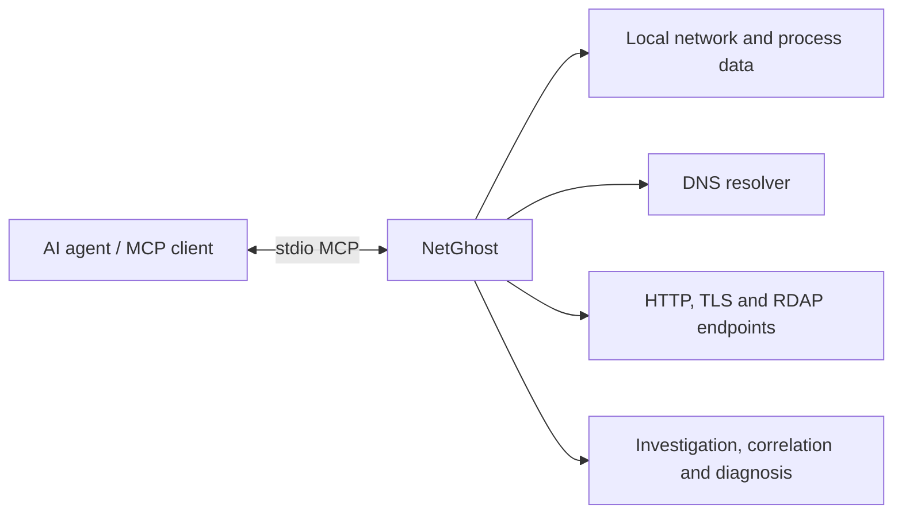

# NetGhost

NetGhost is a local-first MCP server for network diagnostics. It gives an AI agent structured observations about the host network, DNS, connectivity, routes, active connections, HTTP responses and TLS certificates. It does not scan ports, crawl subdomains, or make reputation or vulnerability claims.



## Requirements

- macOS or Linux
- Python 3.13 or newer
- `uv` (recommended)
- `traceroute` for route diagnostics (optional; other tools work without it)

## Install and run

```sh
cd /path/to/NetGhost
uv sync
uv run netghost
```

Or install the project into the active Python environment with `uv pip install .` and run `netghost`.

## MCP client configuration

For Claude Desktop or another stdio MCP client, use the absolute path to `uv` and the project directory:

```json
{
  "mcpServers": {
    "netghost": {
      "command": "/absolute/path/to/uv",
      "args": ["--directory", "/absolute/path/to/NetGhost", "run", "netghost"]
    }
  }
}
```

Replace both paths with paths on your machine. Restart the MCP client after updating its configuration.

## Available tools

| Tool | Purpose |
| --- | --- |
| `netghost_status` | Server version and runtime health |
| `netghost_network_interfaces` | Interface IP/MAC, MTU, traffic counters and default gateway |
| `netghost_dns_lookup` | A, AAAA, MX, NS, TXT, CNAME or PTR lookup |
| `netghost_dns_configuration` | Configured DNS resolvers and search domains |
| `netghost_measure_latency` | Bounded ping sample, latency statistics and jitter |
| `netghost_measure_packet_loss` | Packet loss from bounded ICMP probes |
| `netghost_traceroute` | Route and per-hop latency using the system traceroute utility |
| `netghost_active_connections` | TCP/UDP connections with optional state, process and remote-IP filters |
| `netghost_ip_intelligence` | Public IP allocation and registration data through RDAP |
| `netghost_http_inspect` | HTTP status, headers, redirect chain, timing and final URL |
| `netghost_tls_inspect` | TLS certificate identity, SANs, validity and hostname validation |
| `netghost_investigate` | Run a bounded, evidence-based diagnostic workflow |

All tools return JSON-compatible objects with a status field or execution status, and validate inputs and timeouts. Interface and connection tools can reveal local addresses, MAC addresses, process names and PIDs; share their output only with trusted agents. HTTP inspection makes a GET request (with a one-byte Range request) and follows at most ten redirects. RDAP lookups require internet access and are limited to public IPs.

## Development

```sh
uv sync --group dev
uv run pytest
uv run ruff check src tests
```

NetGhost is licensed under the MIT License; see [LICENSE](LICENSE).
